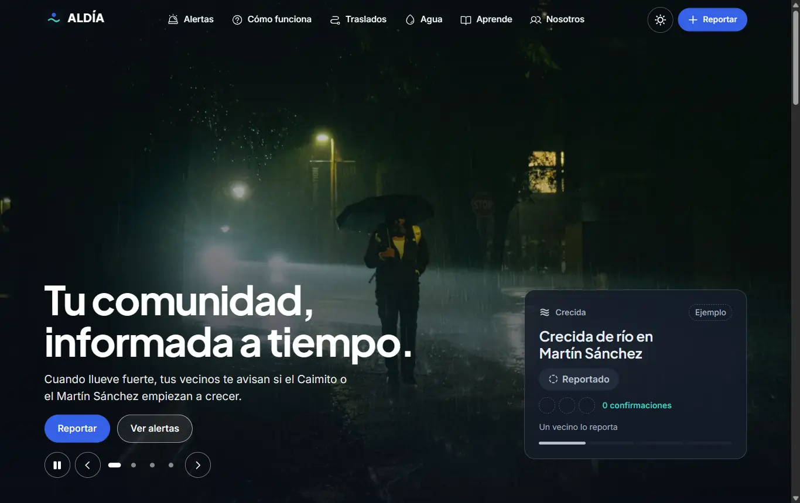
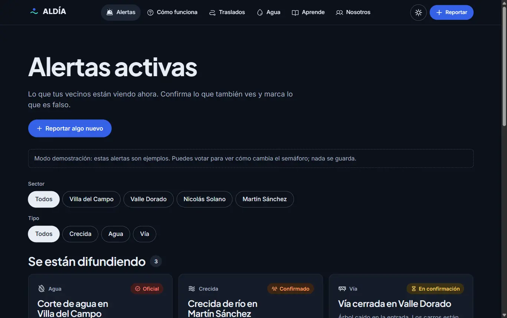
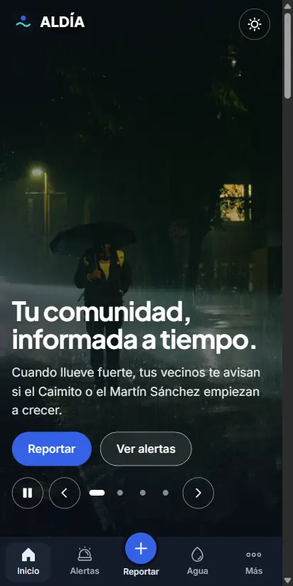
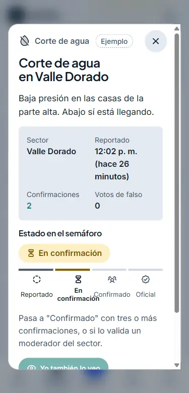

# ALDÍA: tu comunidad, informada a tiempo

Plataforma comunitaria de alerta colaborativa para **Villa del Campo, Valle Dorado, Nicolás Solano y Martín Sánchez** (La Chorrera, Panamá Oeste). Ayuda a los vecinos a enterarse a tiempo de:

- crecidas de los ríos Caimito y Martín Sánchez;
- cortes de agua (potabilizadora Jaime Díaz Quintero, "El Trapichito");
- vías cerradas;
- necesidades de traslado al Hospital Nicolás A. Solano.

ALDÍA **no sustituye** a SINAPROC, al IDAAN ni a los servicios de emergencia: los complementa. En una emergencia, llama al 911.

> **Idea clave:** la información es confiable porque la comunidad la construye en conjunto, no porque lo diga una sola persona.

Proyecto N.° 1 de Sistemas Colaborativos (Universidad Tecnológica de Panamá): impacto social del trabajo en equipo a través de las TIC.

## Capturas

| Inicio (escritorio) | Alertas activas |
| --- | --- |
|  |  |

| Inicio (teléfono) | Detalle de una alerta | Reporte enviado |
| --- | --- | --- |
|  |  |  |

## Cómo funciona el semáforo

Cada alerta sube o baja de nivel según lo que confirma la comunidad. **El nivel lo calcula la base de datos**, nunca el navegador.

| Nivel | Cuándo | Qué pasa |
| --- | --- | --- |
| **Reportado** | Una persona lo reportó. | No se difunde; queda en "Por confirmar". |
| **En confirmación** | 2 vecinos distintos (no quien reportó) lo confirman en menos de 30 min. | Aparece en Alertas activas. |
| **Confirmado por la comunidad** | 3 o más confirmaciones, o lo valida un moderador del sector. | Se puede difundir en el grupo del sector. |
| **Oficial** | Un moderador lo respalda con el enlace (https) de SINAPROC, el IDAAN o el Municipio. | Muestra la fuente oficial. |

Reglas adicionales:

- **Una persona, un voto.** La base de datos lo impone con `UNIQUE(reporte_id, user_id)`.
- **Nadie confirma su propio reporte.**
- **"Esto es falso":** si los votos de falso superan a las confirmaciones, el reporte baja un nivel. Las decisiones de los moderadores no bajan por votos.
- **Caducidad:** dos horas sin confirmaciones y la alerta se archiva. Las oficiales solo las cierra un moderador.

En la interfaz, cada nivel lleva siempre ícono y texto, nunca solo color.

## Tecnologías

- **React 19 + Vite 8:** la app, dividida en páginas que se cargan por separado.
- **wouter:** enrutador liviano (~2 KB).
- **Motion** (motion.dev): animaciones.
- **Supabase:** Postgres, Anonymous Sign-ins, RLS y Realtime.
- **Íconos:** Phosphor.
- **Fuentes:** Plus Jakarta Sans (títulos) e Inter (texto), solo el subconjunto latino.
- **Estilos:** CSS Modules con tokens de diseño en variables CSS, tema claro y oscuro.

### Animaciones

Todas respetan `prefers-reduced-motion`.

| Animación | Dónde |
| --- | --- |
| Fundido cruzado | Carruseles y cambio de filtros de alertas |
| Elemento compartido | El título de una alerta "viaja" de la tarjeta al detalle (`layoutId`) |
| Magnificación tipo dock | Íconos del menú en escritorio |
| Desenfoque del fondo | Al abrir el formulario de reporte o un detalle |
| Aparición escalonada | Tarjetas al hacer scroll |
| Contadores animados | Cifras de la portada |
| Cambio de nivel | La insignia del semáforo cambia con un pulso al llegar una confirmación |
| Texto al hacer scroll | La idea clave se "enciende" palabra por palabra |

## Estructura del proyecto

```
index.html                  Punto de entrada (incluye la vista previa del hero)
public/                     Foto principal, fuentes, favicon, robots.txt
src/
  main.jsx                  Arranque diferido de la app
  arranque.jsx              Router, MotionConfig y proveedor de datos
  App.jsx                   Rutas
  styles/                   tokens.css (colores, tipografía, modo oscuro) y base.css
  data/                     Contenido separado del diseño: catálogos, semáforo, textos, fotos
  lib/                      Cliente de Supabase, validación (con pruebas), formato de horas
  services/                 Acceso a datos: alertas.js y moderacion.js
  context/                  Estado global (datos y apertura del formulario)
  hooks/                    useTema, useAhora
  components/
    layout/                 Header, NavMovil, Footer, Layout
    inicio/                 Hero, TarjetaFlotante, IdeaClave, SemaforoPasos...
    alertas/                AlertaCard, DetalleAlerta, Filtros, Formulario, VotoBotones
    ui/                     Carrusel, Modal, EstadoBadge, Contador, Foto...
  pages/                    Una página por sección
supabase/
  migrations/               Tablas, vista del semáforo, RLS y funciones
  pruebas/                  Pruebas de las migraciones en Postgres (PGlite)
docs/capturas/              Capturas del README
```

## Cómo correrlo

Requisitos: Node.js 20 o superior.

```bash
npm install
npm run dev        # http://localhost:5173
```

Sin configurar Supabase, el sitio corre en **modo demostración**:

- muestra alertas de ejemplo, todas marcadas como "Ejemplo";
- deja votar y reportar para ver cómo cambia el semáforo, pero nada se guarda.

Otros comandos:

```bash
npm run build      # versión de producción en dist/
npm run preview    # sirve dist/ en http://localhost:4173
npm test           # pruebas de la validación del formulario
npm run test:db    # pruebas de las migraciones (42 comprobaciones de seguridad y semáforo)
```

### Conectar Supabase

1. Aplica las migraciones de `supabase/migrations/` en orden. Puedes usar el SQL Editor del panel o `supabase db push`.
2. En **Authentication > Sign In / Providers**, activa **Allow anonymous sign-ins**. Se recomienda activar también CAPTCHA (Turnstile o hCaptcha) para frenar abusos.
3. Copia `.env.example` como `.env.local` y pega la **clave publicable** (`sb_publishable_...` o `anon`). Nunca uses la clave `secret` ni la `service_role` en el navegador.
4. Para crear un moderador:
   - Crea el usuario con correo y contraseña en **Authentication > Users**.
   - Regístralo en el SQL Editor:

   ```sql
   insert into public.moderadores (user_id, sector)
   values ('<uuid del usuario>', 'villa-del-campo'); -- sector null = todos los sectores
   ```

   El acceso para moderadores está en `/moderar`, enlazado en el pie de página.

## Seguridad

- **RLS activado en todas las tablas** y privilegios mínimos. Se revoca todo y se concede solo lo necesario, columna por columna.
- **Anonymous Sign-ins:** cada vecino tiene un `user_id` sin crear cuenta. Así "una persona, un voto" se controla en la base de datos.
- **El navegador no decide nada importante:**
  - el nivel del semáforo se calcula en la vista `public.alertas`;
  - los contadores los mantienen disparadores;
  - el cliente solo puede escribir `sector`, `tipo` y `descripcion`.
- **Moderación** solo con cuenta real (no anónima) y del sector correspondiente, a través de funciones `security definer` que lo comprueban por dentro.
- **Validación doble.** El cliente da mensajes claros. La base de datos lo impone con `CHECK`:
  - catálogos cerrados;
  - descripción de 10 a 280 caracteres;
  - sin números de teléfono;
  - enlaces oficiales solo `https`.
- **Límite de 5 reportes por hora** por persona, con bloqueo para que sea exacto aunque lleguen reportes a la vez.
- **Privacidad:**
  - no se guardan nombres ni teléfonos;
  - el `user_id` no se puede leer desde el cliente;
  - nadie ve quién votó qué;
  - las solicitudes de traslado solo las ven quien la pidió y el moderador del sector.
- **Tiempo real sin filtrar datos:** Realtime no publica la tabla de reportes, porque el evento llevaría la fila completa. Solo publica una marca de tiempo, y cada cliente vuelve a leer con sus propios permisos.
- **XSS:** el texto de los usuarios se muestra siempre como texto (React escapa por defecto; no se usa `innerHTML` ni `dangerouslySetInnerHTML`). Probado con ``.

## Accesibilidad y rendimiento

- Contraste AA en ambos temas, foco visible, navegación completa con teclado, enlace "Saltar al contenido".
- Carruseles con pausa y con flechas del teclado.
- Diálogos que atrapan el foco, se cierran con Escape y devuelven el foco al botón que los abrió.
- Diseño pensado primero para el teléfono, probado a 375 px.
- Imágenes WebP con tamaño reservado (CLS 0) y carga diferida.

Lighthouse móvil (`npm run build && npm run preview`, Lighthouse 12):

| Página | Rendimiento | Accesibilidad | Buenas prácticas | SEO |
| --- | --- | --- | --- | --- |
| Inicio | 98-99 | 100 | 100 | 100 |
| Alertas | ~90 | 100 | 100 | 100 |
| Cómo funciona | ~89 | 100 | 100 | 100 |

El inicio carga rápido gracias a una **vista previa estática** del hero en `index.html`:

1. La foto y el título se pintan antes de que llegue JavaScript.
2. React se descarga cuando el navegador confirma que esa foto ya se pintó.
3. El hero de React reutiliza esa misma foto en lugar de crear otra.

Si cambias el diseño del hero, ajusta también los estilos de la vista previa en `index.html`.

## Créditos

- **Fotos:** [Unsplash](https://unsplash.com/license), con licencia de uso libre, de Sohan Shingade, yusrizal iskadi, George Lopez, Quilia, Kiran Naidu, Ruan Richard Rodrigues y Wes Hicks. Los enlaces a cada foto están en el pie del sitio.
- **Fuentes:** Plus Jakarta Sans e Inter, licencia SIL Open Font License.
- **Íconos:** Phosphor Icons, licencia MIT.
- El sitio no usa logos ni fotos de SINAPROC, IDAAN ni del Municipio: no es una página oficial. Los escenarios y alertas de ejemplo son ficticios y están marcados como tal.

## Equipo

| Integrante | Rol |
| --- | --- |
| Jair Morales | Líder del proyecto y desarrollo web |
| Josh Amaya | Diseño gráfico: logo e infografía |
| Antony Ortiz | Redacción y contenido |

## Pendientes

- Logo e infografía del semáforo (Canva): los espacios están marcados en Nosotros y en Cómo funciona.
- Enlaces a los grupos de WhatsApp de cada sector.
- Despliegue en GitHub Pages (`BASE_PATH=/<repo>/` en el build).
